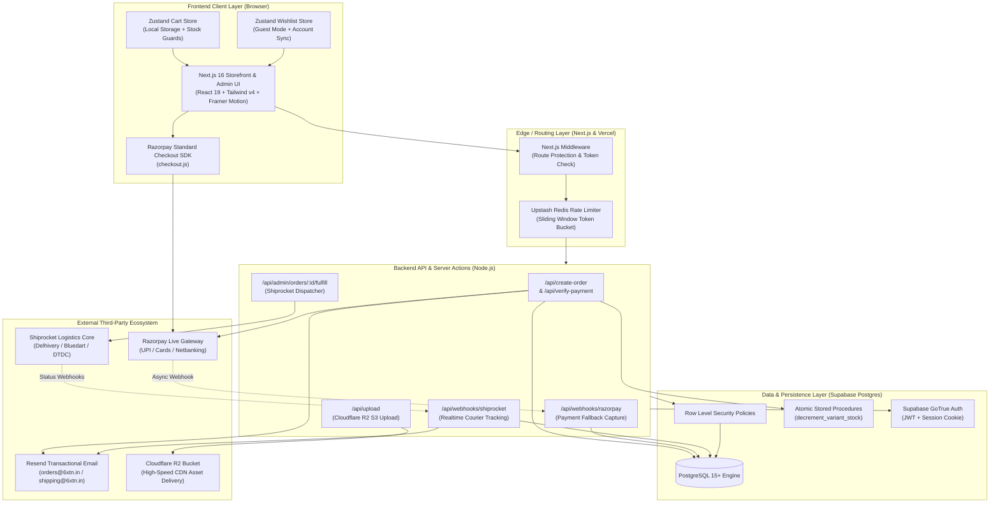
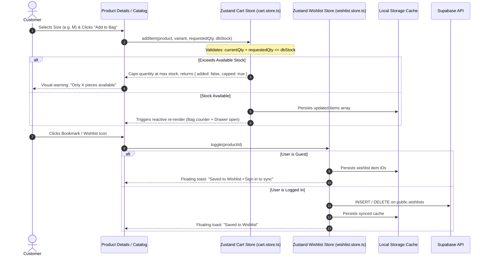
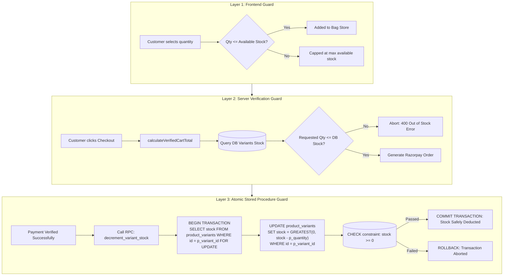
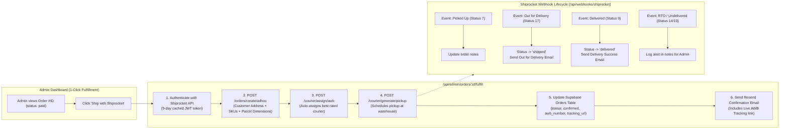
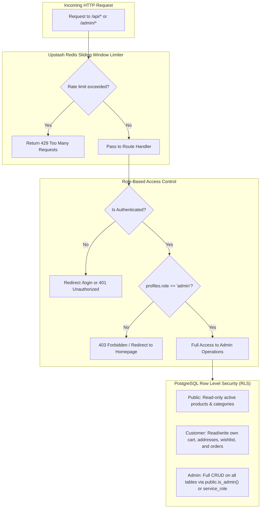
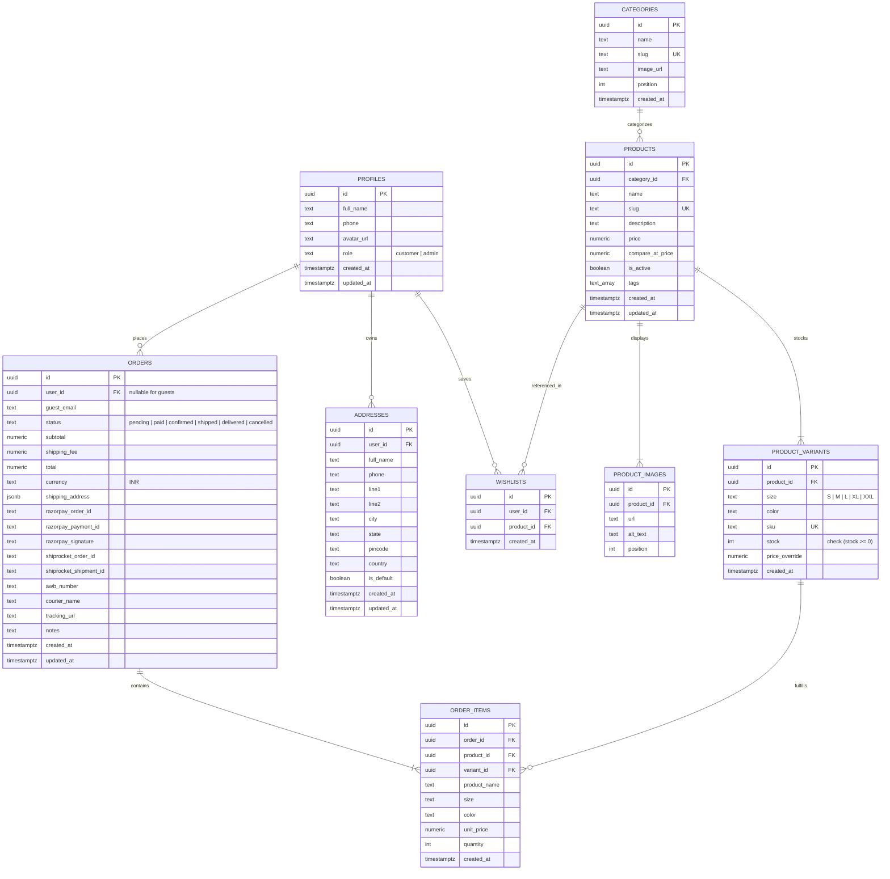

# 6XTN — System Architecture & Reactive Technical Design

**Version:** 2.0 (Production Verified)  
**Last Updated:** October 2026  
**Status:** Live & Production Ready  
**Repository:** `Koushikchikkond/sxtn-clothing`  

---

## 1. High-Level System Context

6XTN is an automated, event-driven luxury streetwear e-commerce platform built for high concurrency, zero overselling, automated logistics, and sub-second page performance.

---

## 2. Core Reactive State Flow (Client-Side)

The client uses **Zustand** stores with custom persistence middleware and reactive sync mechanisms.

---

## 3. End-to-End Order & Payment Reactive Pipeline

This pipeline guarantees financial accuracy and prevents tampering with prices, stock levels, or amounts.

```mermaid
sequenceDiagram
    autonumber
    actor Customer as Customer Browser
    participant Checkout as /checkout Page
    participant CreateOrder as /api/create-order
    participant Razorpay as Razorpay Live Gateway
    participant VerifyPayment as /api/verify-payment
    participant Postgres as Supabase PostgreSQL
    participant StockRPC as RPC: decrement_variant_stock
    participant Resend as Resend Email Service

    Customer->>Checkout: Clicks "Pay & Place Order"
    Checkout->>CreateOrder: POST { items, address, guestEmail }
    
    rect rgb(20, 20, 20)
        Note over CreateOrder,Postgres: Server-Side Price & Stock Verification
        CreateOrder->>Postgres: Query product_variants & products (Real-time DB query)
        Postgres-->>CreateOrder: Returns active price & available stock
        Note over CreateOrder: Recalculates subtotal + shippingFee (Never trusts client total)
        Note over CreateOrder: Checks: item.quantity <= variant.stock
    end

    CreateOrder->>Razorpay: orders.create({ amount: verifiedTotalInPaise, currency: "INR" })
    Razorpay-->>CreateOrder: Returns { razorpay_order_id, amount }
    CreateOrder-->>Checkout: Returns { orderId, amount, currency }

    Checkout->>Razorpay: Opens Razorpay Standard Modal (checkout.js)
    Customer->>Razorpay: Authorizes Payment via UPI / Card / Netbanking
    Razorpay-->>Checkout: Returns { razorpay_payment_id, razorpay_order_id, razorpay_signature }

    Checkout->>VerifyPayment: POST { order_id, payment_id, signature, items, address, total }

    rect rgb(20, 20, 20)
        Note over VerifyPayment: Cryptographic HMAC Signature Verification
        VerifyPayment->>VerifyPayment: HMAC-SHA256(order_id + "|" + payment_id, RAZORPAY_KEY_SECRET)
        Note over VerifyPayment: Compares generated digest === received signature
    end

    alt Signature Matches
        VerifyPayment->>Postgres: INSERT into public.orders (status: 'paid')
        VerifyPayment->>Postgres: INSERT into public.order_items (line items)
        
        loop For Each Purchased Variant
            VerifyPayment->>StockRPC: SELECT decrement_variant_stock(variantId, quantity)
            StockRPC->>Postgres: UPDATE product_variants SET stock = GREATEST(0, stock - qty)
        end

        VerifyPayment->>Resend: sendOrderConfirmationEmail(customerEmail, orderDetails)
        VerifyPayment-->>Checkout: Returns { success: true, orderId }
        Checkout-->>Customer: Redirects to /order-success?order_id=XXX
    else Signature Invalid
        VerifyPayment-->>Checkout: Returns 400 Bad Signature (Order rejected)
    end
```

---

## 4. Atomic Inventory Concurrency Guard

To prevent race conditions during flash drops (e.g., 100 users trying to buy the last 2 pieces simultaneously), stock management is guarded at both the application level and the database engine level.

---

## 5. Automated Logistics & Shipping Engine (Shiprocket)

Order fulfillment integrates directly with Shiprocket's REST APIs and automated webhooks.

---

## 6. Security, Rate Limiting & Access Control (RBAC)

---

## 7. Database Entity Relationship Diagram (ERD)

---

## 8. System Sync Protocol (How to keep this document updated)

Whenever new features, migrations, or third-party integrations are made, update this document according to this table:

| If you modify... | Update this section in `SYSTEM_DESIGN.md` | Specific Diagram / Table to edit |
| :--- | :--- | :--- |
| **New Database Migration** (`supabase/migrations/`) | Section 7 (ERD) & Section 4 (Inventory) | Update Mermaid `erDiagram` with new columns/tables and RPCs |
| **New API Route** (`app/api/`) | Section 1 (Context) & Section 6 (RBAC) | Add route to `ServerLayer` and map permission rules |
| **New Frontend Store / State** (`lib/stores/`) | Section 2 (Client Reactive State) | Update Mermaid `sequenceDiagram` for client state hydration |
| **Payment Gateway or Checkout rules** | Section 3 (Payment Pipeline) | Update HMAC validation, amount rules, or checkout steps |
| **Courier / Logistics updates** | Section 5 (Shipping Engine) | Update Shiprocket endpoints or webhook event status codes |
| **New Auth Roles or Permissions** | Section 6 (Security & RBAC) | Update role hierarchy (`customer`, `admin`, etc.) |

---

*This document is version-controlled directly in the repository and serves as the single source of architectural truth for 6XTN.*
