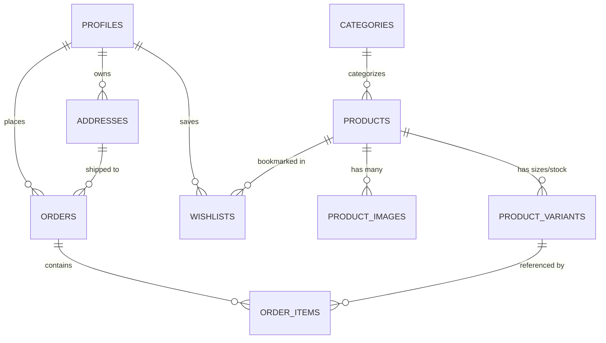

# 🗄️ SXTN Database Schema & Data Models

> [!abstract] Overview
> SXTN relies on a hardened PostgreSQL 15 database hosted on Supabase. Every table has Row Level Security (RLS) enabled. Triggers handle automated profile provisioning, timestamp maintenance, and privilege escalation guards.

---

## 1. Entity Relationship Overview



---

## 2. Table Specifications

### 1. `profiles`
Extends Supabase's `auth.users` system table.
```sql
create table public.profiles (
  id          uuid primary key references auth.users(id) on delete cascade,
  full_name   text,
  phone       text,
  avatar_url  text,
  role        text not null default 'customer' check (role in ('customer', 'admin')),
  created_at  timestamptz not null default now(),
  updated_at  timestamptz not null default now()
);
```

### 2. `categories`
Product groupings (e.g., T-Shirts, Hoodies, Cargo, Accessories).
```sql
create table public.categories (
  id          uuid primary key default gen_random_uuid(),
  name        text not null,
  slug        text unique not null,
  image_url   text,
  position    int not null default 0,
  created_at  timestamptz not null default now()
);
```

### 3. `products`
Master catalog items.
```sql
create table public.products (
  id                uuid primary key default gen_random_uuid(),
  category_id       uuid references public.categories(id) on delete set null,
  name              text not null,
  slug              text unique not null,
  description       text,
  price             numeric(10,2) not null check (price >= 0),
  compare_at_price  numeric(10,2) check (compare_at_price >= 0),
  is_active         boolean not null default true,
  tags              text[] not null default '{}',
  created_at        timestamptz not null default now(),
  updated_at        timestamptz not null default now()
);
```

### 4. `product_images`
Ordered photo galleries for products.
```sql
create table public.product_images (
  id          uuid primary key default gen_random_uuid(),
  product_id  uuid not null references public.products(id) on delete cascade,
  url         text not null,
  alt_text    text,
  position    int not null default 0
);
```

### 5. `product_variants`
Size and inventory SKUs.
```sql
create table public.product_variants (
  id             uuid primary key default gen_random_uuid(),
  product_id     uuid not null references public.products(id) on delete cascade,
  size           text not null,   -- S | M | L | XL | XXL
  color          text,
  sku            text unique,
  stock          int not null default 0 check (stock >= 0),
  price_override numeric(10,2) check (price_override >= 0)
);
```

### 6. `addresses`
Saved delivery addresses for registered customers.
```sql
create table public.addresses (
  id          uuid primary key default gen_random_uuid(),
  user_id     uuid not null references public.profiles(id) on delete cascade,
  full_name   text not null,
  phone       text not null,
  line1       text not null,
  line2       text,
  city        text not null,
  state       text not null,
  pincode     text not null,
  is_default  boolean not null default false,
  created_at  timestamptz not null default now()
);
```

### 7. `orders`
Master purchase records supporting registered and guest checkout.
```sql
create table public.orders (
  id                     uuid primary key default gen_random_uuid(),
  user_id                uuid references public.profiles(id) on delete set null,
  guest_email            text,
  address_id             uuid references public.addresses(id) on delete set null,
  shipping_address       jsonb,   -- immutable snapshot at order time
  status                 text not null default 'pending'
                           check (status in ('pending','paid','confirmed','shipped','delivered','cancelled')),
  subtotal               numeric(10,2) not null check (subtotal >= 0),
  shipping_fee           numeric(10,2) not null default 0 check (shipping_fee >= 0),
  total                  numeric(10,2) not null check (total >= 0),
  razorpay_order_id      text,
  razorpay_payment_id    text,
  notes                  text,
  shiprocket_order_id    text,
  shiprocket_shipment_id text,
  awb_number             text,
  courier_name           text,
  tracking_url           text,
  created_at             timestamptz not null default now(),
  updated_at             timestamptz not null default now()
);
```

### 8. `order_items`
Immutable line-item snapshot of products purchased in an order.
```sql
create table public.order_items (
  id            uuid primary key default gen_random_uuid(),
  order_id      uuid not null references public.orders(id) on delete cascade,
  variant_id    uuid references public.product_variants(id) on delete set null,
  product_name  text not null,
  size          text,
  color         text,
  quantity      int not null check (quantity > 0),
  unit_price    numeric(10,2) not null check (unit_price >= 0)
);
```

### 9. `wishlists`
Many-to-many relationship between profiles and products.
```sql
create table public.wishlists (
  user_id     uuid not null references public.profiles(id) on delete cascade,
  product_id  uuid not null references public.products(id) on delete cascade,
  created_at  timestamptz not null default now(),
  primary key (user_id, product_id)
);
```

### 10. `site_settings`
Dynamic key-value JSON store for site-wide banners and configurations.
```sql
create table public.site_settings (
  key         text primary key,
  value       jsonb not null,
  updated_at  timestamptz default now()
);
```

---

## 3. Database Indexes

| Index Name | Table | Columns | Purpose |
|---|---|---|---|
| `idx_products_slug` | `products` | `slug` | Instant O(1) lookup on product pages (`/products/[slug]`) |
| `idx_products_category` | `products` | `category_id` | Fast collection filtering (`/collections/[slug]`) |
| `idx_products_active` | `products` | `is_active` | Quick filtering of active vs draft products |
| `idx_product_variants_pid` | `product_variants` | `product_id` | Joins for variant stock and sizes on PDP |
| `idx_product_images_pid` | `product_images` | `product_id` | Joins for product gallery rendering |
| `idx_orders_user_id` | `orders` | `user_id` | Account dashboard order history |
| `idx_orders_status` | `orders` | `status` | Admin order queue filtering |
| `orders_shiprocket_order_id_idx` | `orders` | `shiprocket_order_id` | Shiprocket webhook lookup |
| `orders_awb_number_idx` | `orders` | `awb_number` | Courier AWB tracking lookup |

---

## 4. Functions & Triggers

### 1. New User Profile Provisioning
- **Trigger**: `on_auth_user_created` on `auth.users`
- **Function**: `handle_new_user()`
- Automatically creates a row in `public.profiles` with the new user's `id`, `full_name`, and `avatar_url` extracted from auth metadata. Default role is `'customer'`.

### 2. Privilege Escalation Guard
- **Trigger**: `enforce_profile_role_protection` on `public.profiles`
- **Function**: `check_profile_role_update()`
- **Security Check**: Blocks non-admin users from altering their own role in `public.profiles` via Supabase client requests. Only existing admins can promote users.

### 3. Automated `updated_at` Timestamps
- **Trigger**: `set_*_updated_at` on `profiles`, `products`, `orders`
- **Function**: `set_updated_at()`
- Sets `new.updated_at = now()` on every record update.

### 4. Atomic Inventory Management (RPC)
- **`decrement_variant_stock(p_variant_id uuid, p_quantity int)`**:
  - Decrements variant stock safely: `stock = greatest(0, stock - p_quantity)`.
  - Permissions: Public execution revoked; granted only to `service_role`.
- **`increment_variant_stock(p_variant_id uuid, p_quantity int)`**:
  - Increments stock on order cancellation: `stock = stock + greatest(0, p_quantity)`.
  - Permissions: Restricted to `service_role`.

---

## 5. Row Level Security (RLS) Policy Matrix

| Table | Public / Guest | Authenticated Customer | Admin |
|---|---|---|---|
| `categories` | Read-only | Read-only | Full CRUD |
| `products` | Read active (`is_active = true`) | Read active | Full CRUD |
| `product_images` | Read-only | Read-only | Full CRUD |
| `product_variants` | Read-only | Read-only | Full CRUD |
| `profiles` | None | Read & Update own record (`id = auth.uid()`) | Full CRUD |
| `addresses` | None | Full CRUD on own records (`user_id = auth.uid()`) | Full CRUD |
| `orders` | None | Read own orders (`user_id = auth.uid()`) | Full CRUD |
| `order_items` | None | Read items belonging to own orders | Full CRUD |
| `wishlists` | None | Full CRUD on own wishlist (`user_id = auth.uid()`) | Full CRUD |
| `site_settings` | Read-only | Read-only | Full CRUD |

