# 🔄 SXTN State Management & Data Flow

> [!abstract] Overview
> SXTN separates state into three distinct layers: local client state (Zustand with persistent local storage), server-rendered caching (RSC with ISR), and transactional server-authoritative mutations (Serverless Route Handlers + Supabase RPC).

---

## 1. Client State (Zustand Stores)

### 1. Cart Store (`lib/stores/cart.store.ts`)
The cart store manages cart items, drawer visibility, and stock caps.

```typescript
export interface CartItem {
  variantId: string;
  productId: string;
  productSlug: string;
  name: string;
  imageUrl: string;
  price: number;
  size: string;
  color: string | null;
  quantity: number;
  stock: number; // Stored to enforce instant client capping
}
```

#### Key Cart Behaviors:
- **Automatic Stock Capping**: When adding an item or increasing quantity, `addItem` checks `Math.min(newQty, stock)`. If the user attempts to add more items than physically available in stock, the store automatically caps the quantity and flags `capped: true`, triggering a toast alert.
- **Persistence**: Persisted to the browser's `localStorage` under key `sxtn-cart-v1`. Reloading or closing the tab preserves the user's cart.
- **Selectors**:
  - `itemCount()`: Sums total units across all variants for the header badge.
  - `subtotal()`: Dynamically calculates `sum(price * quantity)`.

### 2. Wishlist Store (`lib/stores/wishlist.store.ts`)
Operates as a **hybrid** guest/authenticated bookmarking engine.

#### Hybrid Sync Architecture:
- **Guest Visitor**: Saves bookmarked product IDs to `localStorage` under `sxtn-wishlist-v1`.
- **Authenticated User**: When toggling an item, if `supabase.auth.getUser()` detects an active session, it automatically writes an upsert/delete to `public.wishlists`.
- **Session Bridge**: When a guest logs in or signs up, `syncWithAccount()` merges all local guest bookmarks into the user's permanent Supabase database profile.

---

## 2. End-to-End Checkout Transaction Lifecycle

The checkout and order verification flow adheres to zero-trust security:

```mermaid
sequenceDiagram
    autonumber
    actor Customer as Shopper (Browser)
    participant Cart as Zustand Store
    participant Checkout as /checkout Page
    participant APIOrder as /api/create-order
    participant DB as Supabase Postgres
    participant RP as Razorpay Gateway
    participant APIVerify as /api/verify-payment
    participant RPC as decrement_variant_stock (RPC)
    participant Resend as Resend Email

    Customer->>Checkout: Fills shipping address & clicks Pay
    Checkout->>APIOrder: POST { items: [{ variantId, quantity }] }
    
    rect rgb(20, 20, 30)
    Note over APIOrder,DB: Server-Side Price Verification
    APIOrder->>DB: Fetch genuine prices & stock from product_variants
    DB-->>APIOrder: Return validated database records
    APIOrder->>APIOrder: Compute Subtotal + Shipping (Paise)
    end

    APIOrder->>RP: orders.create({ amount: verifiedTotalPaise })
    RP-->>APIOrder: Return { order_id, amount, currency }
    APIOrder-->>Checkout: Return order_id + public keyId

    Checkout->>RP: Razorpay.open() Modal
    Customer->>RP: Completes payment (UPI / Card / Netbanking)
    RP-->>Checkout: Returns { razorpay_order_id, razorpay_payment_id, razorpay_signature }

    Checkout->>APIVerify: POST { razorpay_order_id, razorpay_payment_id, razorpay_signature, items, address }

    rect rgb(30, 20, 20)
    Note over APIVerify: Cryptographic HMAC Verification
    APIVerify->>APIVerify: crypto.createHmac("sha256", secret).digest("hex") === signature
    end

    APIVerify->>DB: Check idempotency (razorpay_payment_id)
    APIVerify->>DB: INSERT into orders & order_items (status: 'paid')
    APIVerify->>RPC: Call decrement_variant_stock(variantId, qty)
    RPC-->>APIVerify: Stock safely decremented (stock >= 0)
    
    APIVerify->>Resend: sendOrderConfirmationEmail() [Awaited]
    Resend-->>APIVerify: Receipt dispatched
    
    APIVerify-->>Checkout: Return { success: true, orderId }
    Checkout->>Cart: clearCart()
    Checkout->>Customer: Redirect to /order-success?orderId=...
```



---

## 3. Idempotency & Concurrency Safeguards

1. **Duplicate Payment Replay Prevention**:
   Before creating an order in `/api/verify-payment`, the endpoint queries:
   ```typescript
   const { data: existingOrder } = await adminDb
     .from("orders")
     .select("id")
     .eq("razorpay_payment_id", razorpay_payment_id)
     .maybeSingle();
   ```
   If already processed, it immediately returns the existing `orderId` without executing duplicate stock decrements or sending multiple emails.

2. **Atomic Inventory Locks via RPC**:
   Inventory is decremented using the PostgreSQL function:
   ```sql
   update public.product_variants
   set stock = greatest(0, stock - p_quantity)
   where id = p_variant_id;
   ```
   Combined with the table-level constraint `check (stock >= 0)`, the database engine serializes concurrent decrements, preventing race-condition overselling during flash drops.

3. **Asynchronous Webhook Reconciliation**:
   If a user's mobile browser crashes or loses internet connectivity after completing payment at Razorpay before returning to `/api/verify-payment`, Razorpay's server sends a background webhook to `/api/webhooks/razorpay` (`order.paid` or `payment.captured`). The webhook handler automatically locates the order, transitions it to `paid`, decrements stock, and triggers confirmation emails.

