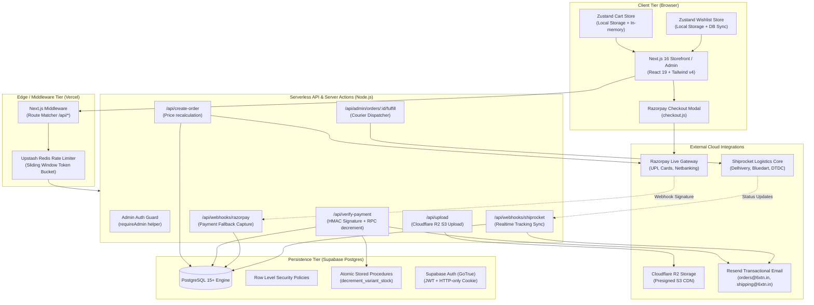

# 🏗️ SXTN System Architecture & Topology

> [!info] Architectural Vision
> SXTN is engineered as an event-driven, serverless-first commerce engine designed for sub-second page delivery, zero overselling through atomic database locks, and strict server-side validation for all transactions.

---

## 1. High-Level Architectural Diagram

---

## 2. Tier Breakdown

### 1. Client Tier (Browser)
- **Hybrid Rendering Model**:
  - **Server Components (RSC)**: Used by default across all static pages, PLP, PDP, and Account views to eliminate client-side bundle weight and perform direct, low-latency database queries.
  - **Client Components (`"use client"`)**: Used exclusively at interaction leaf nodes (e.g., [`components/storefront/cart-drawer.tsx`](file:///d:/personal%20project/SXTN_Webapp/components/storefront/cart-drawer.tsx), [`components/storefront/product-details.tsx`](file:///d:/personal%20project/SXTN_Webapp/components/storefront/product-details.tsx), checkout forms, admin interactive forms).
- **Smooth Scrolling**: Lenis (`lenis/react`) configured in [`app/smooth-scrolling.tsx`](file:///d:/personal%20project/SXTN_Webapp/app/smooth-scrolling.tsx) provides luxurious, editorial inertia scrolling without breaking native anchor jumps.
- **Client Stores**:
  - `useCartStore`: Persistent client cart with auto-capping against database stock levels.
  - `useWishlistStore`: Hybrid wishlist syncing anonymously to `localStorage` and merging into Supabase when authenticated.

### 2. Edge & Middleware Tier
- File: [`middleware.ts`](file:///d:/personal%20project/SXTN_Webapp/middleware.ts)
- Intercepts all incoming requests targeting `/api/:path*`.
- **Sliding-Window Token Bucket**:
  - General API: 30 requests / 10 seconds per IP or user ID.
  - Auth routes: 5 requests / 60 seconds per IP.
  - Checkout routes: 10 requests / 60 seconds per IP.
- **Fail-Open Strategy**: If Upstash Redis experiences a transient network error, middleware fails open to ensure genuine paying customers are never blocked.
- Bypasses static assets, admin internal actions, and webhooks to avoid signature verification timeouts.

### 3. Serverless API Tier
All routes execute on the `nodejs` runtime (configured via `export const runtime = "nodejs"`) because cryptographic operations (HMAC-SHA256 signature verification), Razorpay SDK, AWS S3 Client, and Resend require full Node primitives.

### 4. Persistence & Database Tier (Supabase)
- **Supabase Multi-Client Strategy**:
  - `createClient()` ([`lib/supabase/server.ts`](file:///d:/personal%20project/SXTN_Webapp/lib/supabase/server.ts)): Uses Next.js `cookies()` for SSR/RSC requests under the user's active session, respecting RLS.
  - `createStaticClient()` ([`lib/supabase/static.ts`](file:///d:/personal%20project/SXTN_Webapp/lib/supabase/static.ts)): Uses anonymous key with no cookie handling for ISR pre-rendering and build-time static generation.
  - `createAdminClient()` ([`lib/supabase/admin.ts`](file:///d:/personal%20project/SXTN_Webapp/lib/supabase/admin.ts)): Uses `SUPABASE_SERVICE_ROLE_KEY` exclusively on the server for order creation, stock decrements, and webhook reconciliation. **Never exposed to the client.**

---

## 3. Rendering & Caching Strategy

| Route | Strategy | Revalidation | Why |
|---|---|---|---|
| `/` (Homepage) | SSR with cached hero banner | Dynamic | Realtime hero banner changes & drop visibility |
| `/products/[slug]` | ISR (Incremental Static Regeneration) | 60 seconds | Edge CDN caches PDP; loads in ~30ms during high-volume drops |
| `/collections/[slug]` | ISR with `generateStaticParams` | 60 seconds | High SEO performance and instant category browsing |
| `/checkout` | Client Component (`"use client"`) | Dynamic | Realtime cart state, address selection, Razorpay modal |
| `/account/*` | SSR + Auth Guard | Dynamic (per-user) | Personalized order history and saved addresses |
| `/admin/*` | SSR + Admin Role Guard | Dynamic | Live product/order administration |

---

## 4. Key Security Boundaries

> [!important] Core Security Rules
> 1. **Zero Client Trust on Pricing**: Cart totals and product prices submitted by the client are discarded. The server fetches fresh prices directly from `public.products` and `public.product_variants` before creating a Razorpay order.
> 2. **HMAC Signature Verification**: Razorpay payment signatures are validated using `crypto.createHmac("sha256", keySecret)` before any order is marked as `paid`.
> 3. **Timing-Safe Equality**: Webhook signatures are compared using `crypto.timingSafeEqual` to prevent side-channel timing attacks.
> 4. **Atomic RPC Stock Adjustments**: Stock decrements run inside `decrement_variant_stock()` with a database-level `CHECK (stock >= 0)` constraint, mathematically preventing overselling.
> 5. **Privilege Escalation Protection**: The Postgres trigger `check_profile_role_update` prevents any user from updating their own profile `role` to `'admin'`.

